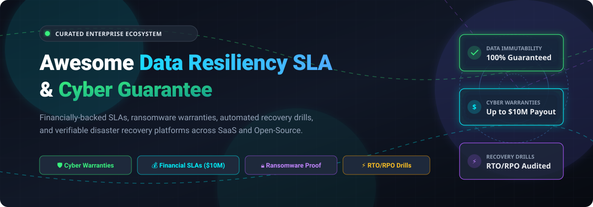

  

# 🛡️ Awesome Data Resiliency SLA & Cyber Guarantee

  
  
  
  
  

A curated directory and enterprise guide to **Data Resiliency SLAs**, **Ransomware Warranties**, and **Cyber Recovery Guarantees** 🔒. Discover enterprise SaaS platforms offering multi-million-dollar contractual coverage and production-tested open-source frameworks for disaster recovery verification, SLA/SLO monitoring, and ransomware canary drills ⚡.

---

## 📑 Table of Contents
- [🌐 Sector Overview & Market Dynamics](#-sector-overview--market-dynamics)
- [🏢 SaaS & Commercial Hosted Platforms](#-saas--commercial-hosted-platforms)
- [💻 Open-Source Verification & SLA Monitoring](#-open-source-verification--sla-monitoring)
- [⚖️ Commercial Guarantees vs. Open-Source Verification](#️-commercial-guarantees-vs-open-source-verification)
- [🤝 How to Contribute](#-how-to-contribute)
- [💖 Support](#-support)
- [📈 Star History](#-star-history)
- [⚠️ Disclaimer](#️-disclaimer)

---

## 🌐 Sector Overview & Market Dynamics

The global **Data Resiliency and Cyber Disaster Recovery market** is estimated at **$25B–$35B in 2026** and projected to surpass **$100B–$140B by the early 2030s**, compounding at a rapid **CAGR of ~15–17%** 📈, driven by escalating ransomware frequencies and stringent regulatory mandates (such as DORA, NIS2, and SEC cyber disclosure rules) 📜. 

The sector is **moderately concentrated at the top with an expanding competitive fringe**: established cybersecurity titans (e.g., CrowdStrike, SentinelOne) and dedicated data resiliency giants (e.g., Veeam, Rubrik, Cohesity-Veritas) command significant enterprise market share, yet intense technological convergence prevents a single "winner-take-all" monopoly 🏛️. Enterprise vendors increasingly leverage financially-backed recovery warranties (ranging from $1M to $10M) not merely as marketing devices, but as competitive contractual moats to signal defense-in-depth maturity and satisfy underwriter demands in the tightening cyber insurance ecosystem 💼.

---

## 🏢 SaaS & Commercial Hosted Platforms

*All SaaS vendors below are ranked in descending order by enterprise size (market capitalization for publicly traded corporations or latest private valuation).* 📊

| Product | Company Scale / Valuation | Pricing (Starting) | Free Tier / Trial Limits | Key Guarantees & SLAs |
|---------|---------------------------|-------------------|--------------------------|-----------------------|
| **[CrowdStrike Falcon Complete](https://www.crowdstrike.com/)** 🦅 | **~$240B+ Market Cap** (Public: NASDAQ: CRWD, FY26 Revenue ~$4.81B) | Starting at **$59.99/device/year** (Falcon Go, min 100 devices; Falcon Complete MDR is custom enterprise quote) | **15-day free trial**; includes NGAV, device control, and mobile protection (no credit card required; up to 100 endpoints) | **Falcon Complete Limited Warranty**: Covers qualified breach remediation expenses up to standard agreement liability caps for Falcon Complete MDR customers. |
| **[Rubrik Security Cloud](https://www.rubrik.com/warranty)** 🧊 | **~$23B–$25B Market Cap** (Public: NYSE: RBRK, FY26 Revenue ~$1.32B) | Starting list benchmark at **~$150–$260/TB/month** (software/SaaS capacity; typical deals start at $50K–$150K/year) | **No perpetual free tier**; scoped sales-assisted trials (e.g., Microsoft 365 trial limited to 500 users & 10 TB capacity) | **Up to $10M Ransomware Recovery Warranty**: Covers recovery costs if Rubrik fails to restore protected data. Requires Enterprise Edition + CEM, MFA, retention lock, and notification within 12h. |
| **[Veeam Data Platform](https://www.veeam.com/legal/ransomware-warranty-agreement.html)** 🟢 | **~$15B Valuation** (Private equity: Insight Partners / TPG, ARR ~$1.7B) | Starting at **$95/workload/year** (Veeam Data Platform Essentials SMB bundle in 5-packs; standard enterprise VUL at $155–$227/workload/year) | **Perpetual Free Community Edition** for up to **10 workloads** (no technical support included); **30-day full-featured free trial** for enterprise suites | **Up to $5M Ransomware Recovery Warranty**: Included with Veeam Data Platform Advanced & Premium. Requires TAM services, quarterly health assessments, and incident notice within 12h. |
| **[Cohesity Data Cloud](https://www.cohesity.com/)** 🧩 | **~$8B Valuation** (Private: Post-Veritas merger, combined ARR ~$1.5B–$1.7B) | Starting at **~$150–$400/TB/year** (software-only BYOH) or **$29,100/year for 10 BETB** on cloud marketplaces | **No perpetual free tier**; offers a **30-day free trial** for cloud-managed DPaaS workloads (capacity restricted during trial period) | **200% Competitor Match Guarantee**: Cohesity matches any published competitor warranty terms and doubles the dollar payout ceiling. |
| **[SentinelOne Singularity](https://www.sentinelone.com/legal/ransomware-warranty/)** 🟣 | **~$7.5B–$8.2B Market Cap** (Public: NYSE: S, FY26 Revenue ~$1.001B) | Starting at **$69.99/endpoint/year** (Singularity Core; Singularity Complete with EDR starts at $179.99/endpoint/year) | **No public self-serve free tier**; structured **14-day to 30-day Proof of Concept (PoC)** available through enterprise sales / authorized MSSP partners | **Up to $1M Ransomware Warranty** ($1,000 per affected endpoint, up to $1M total per company): Requires Protection Mode ON, Anti-Tamper ON, snapshots active, VSS 10% disk allocation, and 24h breach notification. |
| **[Sophos MDR](https://www.sophos.com/en-us/legal/mdr-warranty)** 🛡️ | **~$4B–$5B Valuation** (Private: Thoma Bravo buyout, ARR ~$1.27B, FY25 Revenue ~$1.22B) | Reference list price starting at **~$69.90/endpoint/year** (Endpoint Advanced) and **$200–$240/user/year** for Sophos MDR tiers | **30-day free trial** via Sophos Central; limited to 1,000 objects (users/endpoints) during evaluation with full protection features | **Up to $1M Breach Protection Warranty**: Included at no extra charge with Sophos MDR Complete. Covers up to $1,000/endpoint, up to $100K for ransom payments, legal, PR, and regulatory expenses. |
| **[Acronis Cyber Protect Cloud](https://care.acronis.com/s/article/Acronis-Cyber-Protect-Anti-ransomware-warranty)** 🔵 | **~$3.5B–$4.0B Valuation** (Private: Majority stake by EQT X, Cloud ARR growing >40% YoY) | Per-workload starting models with **$250/month Minimum Commitment** for service providers, or consumer True Image at $49.99/year | **30-day free business trial**; includes unlimited workloads/endpoints and **1 TB of Acronis Cloud Storage** quota during trial | **Up to $1M or 12 months fees Anti-Ransomware Warranty**: Covers endpoints backed up to Acronis-hosted cloud storage. Requires 2FA, immutable storage in Compliance mode, and verified backup validation. |
| **[Druva Data Resiliency Cloud](https://www.druva.com/products/resiliency-guarantee)** ☁️ | **~$1.5B–$2.0B Valuation** (Private: Series H unicorn, SaaS ARR >$200M+) | Starting at **$8.00/user/month** (for M365/workstation endpoints) or consumption credits based on post-deduplication storage | **30-day free trial** for SaaS application backups and cloud workloads (no credit card required; full policy and restore features enabled) | **Up to $10M Data Resiliency Guarantee**: Covers 5 risk dimensions (Cyber, Human, Application, Operational, Environmental) across 5 SLAs (100% Confidentiality, 100% Immutability, 99% Reliability, 99.999% Durability, 99.5% Availability). Tiered payouts start at $100K (for $25K spend) up to $10M (for $1M+ spend). |

---

## 💻 Open-Source Verification & SLA Monitoring

*Open-source platforms provide transparent, auditable verification mechanisms (canaries, recovery sandboxes, and uptime probes) to prove recoverability and track SLAs without relying exclusively on legal promises. Sorted in descending order by GitHub_Stars.* ⭐

| Project | GitHub_Stars | Focus Area & Capabilities | License |
|---------|-------------|----------------------------|---------|
| **[Uptime Kuma](https://github.com/louislam/uptime-kuma)** 🐻 |  | **Self-hosted Uptime & SLA Monitoring Dashboard**: Multi-protocol health checks (HTTP/HTTPS, TCP, Ping, DNS, Docker container status) with SLA availability calculation, incident timeline tracking, and 90+ notification integrations. | MIT |
| **[Restic](https://github.com/restic/restic)** 🔒 |  | **Secure Immutable Backup Engine**: Fast, cryptographically secure deduplicating backup tool. Features built-in `restic check` repository verification, snapshot integrity validation, and append-only cloud storage modes for ransomware resistance. | BSD 2-Clause |
| **[BorgBackup](https://github.com/borgbackup/borg)** 🤖 |  | **Deduplicating Archiver & Authenticated Encryption**: Industry standard for verifiable data protection. Includes tamper-evident repository authentication, append-only mode to prevent ransomware deletion, and `borg check` repair/verification. | BSD 3-Clause |
| **[Velero](https://github.com/velero-io/velero)** ⛵ |  | **Kubernetes Disaster Recovery & Cluster Migration**: Back up and restore Kubernetes cluster resources and persistent volumes. Enables automated multi-region DR drills, scheduled cluster state replication, and CSI volume snapshotting. | Apache 2.0 |
| **[Chaos Mesh](https://github.com/chaos-mesh/chaos-mesh)** 🌪️ |  | **Cloud-Native Chaos Engineering & Resiliency Drill Platform**: Universal chaos orchestrator for Kubernetes. Simulates storage corruptions, network partitions, node failures, and I/O stress to rigorously test automated recovery and SLA resilience. | Apache 2.0 |
| **[Sloth](https://github.com/slok/sloth)** 🦥 |  | **Prometheus Service Level Objective (SLO) Generator**: Automates multi-window multi-burn-rate SLA/SLO alerting and Prometheus metrics generation for SRE teams, enforcing rigorous SLA accountability. | Apache 2.0 |
| **[Pyrra](https://github.com/prometheus-community/pyrra)** 🔥 |  | **SLO Manager for Prometheus & Kubernetes**: Manages and visualizes SLO error budgets, availability burn rates, and compliance reporting through standard Custom Resource Definitions (CRDs). | Apache 2.0 |
| **[Pulse](https://github.com/Erchoc/pulse)** 💓 |  | **Distributed Multi-Probe SLA Monitoring**: Lightweight self-hosted platform with multi-region probes. Features real-time SLA dashboards with latency percentiles (p50/p95/p99), maintenance window exclusions, and webhook alerts. | Apache 2.0 |
| **[FireDrill](https://github.com/kirilurbonas/FireDrill)** 🚒 |  | **Automated Backup Recovery Drills & Audit Evidence**: Restores backups into disposable sandboxes, verifies data integrity byte-exact with ransomware canaries, measures RTO/RPO, and generates signed SOC 2 / ISO 27001 audit evidence. | Apache 2.0 |

---

## ⚖️ Commercial Guarantees vs. Open-Source Verification

| Dimension | Commercial SaaS Warranties & Guarantees 🛡️ | Open-Source Drill & Resiliency Tooling 💻 |
|-----------|-----------------------------------------|----------------------------------------|
| **Core Value** | Financial risk transfer and recovery cost reimbursement (up to $10M). 💰 | Technical proof of recoverability and automated validation. 🔍 |
| **Legal Status** | Contractual warranty (not an insurance policy; subject to strict eligibility clauses). ⚖️ | Open-source software (MIT/Apache 2.0/BSD; AS-IS with no financial warranty). 📜 |
| **Operational Requirements** | Adherence to vendor architecture, MFA, retention lock, TAM services, and tight notification windows (<12–24h). ⏱️ | Self-managed infrastructure, automated CI/CD drills, and self-hosted monitoring. 🛠️ |
| **Auditor / Insurance Acceptance** | Helpful for legal procurement, but underwriters still demand technical proof. 📋 | Emits concrete proof of RTO/RPO compliance for SOC 2 (A1.2), ISO 27001 (A.8.13), and cyber insurers. ✅ |

---

## 🤝 How to Contribute

We welcome contributions from SREs, backup architects, and security engineers! 🚀
1. Fork the repository 🍴
2. Update [README.md](file:///C:/Users/ishan/Documents/Projects/Awesome-Data-Resiliency-Sla-Cyber-Guarantee/README.md) following the established table formats (ensuring pricing and free tier limits are explicitly specified).
3. If adding an open-source project, include the stargazer badge linking to its stargazer page ⭐.
4. Submit a pull request with a brief explanation and links to official documentation 📝.

---

## 💖 Support

Thank you so much for visiting and using this resource! 🙏 If you find this curated ecosystem helpful, please consider:
- ⭐ **Starring** this repository on GitHub
- 🍴 **Forking** it to keep your own reference copy
- 📢 **Sharing** it with colleagues, SRE teams, and cyber resilience architects
- ☕ **Sponsoring** the maintainer or buying a coffee via the [GitHub Sponsor Dashboard](https://github.com/sponsors/ishandutta2007)

Your support keeps this repository up-to-date and continuously expanding! 🚀

---

## 📈 Star History

---

## ⚠️ Disclaimer

- This repository is a community-curated technical index and does not constitute legal, financial, or cybersecurity underwriting advice.
- Vendor cyber guarantees and ransomware warranties are contractual agreements containing specific preconditions, exclusions, notification deadlines, and liability limitations. Always consult qualified legal counsel and insurance underwriters when reviewing commercial terms.
